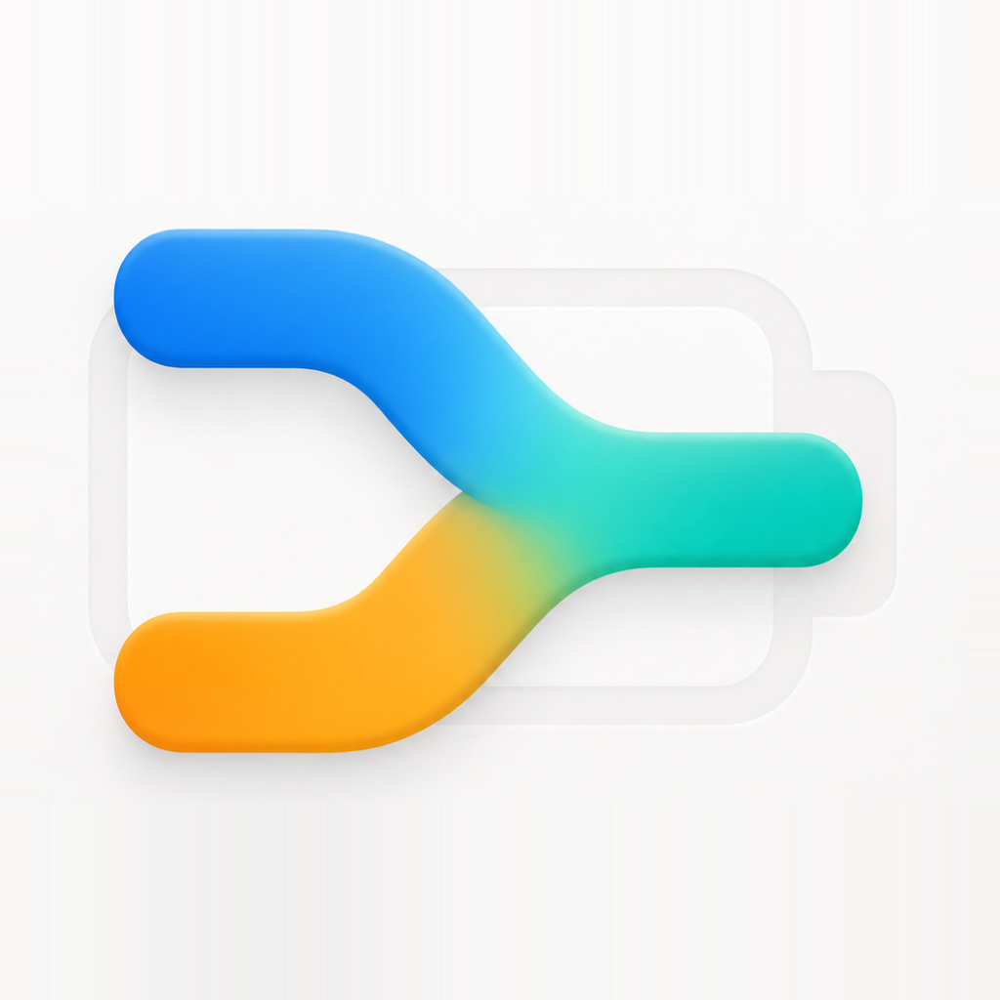
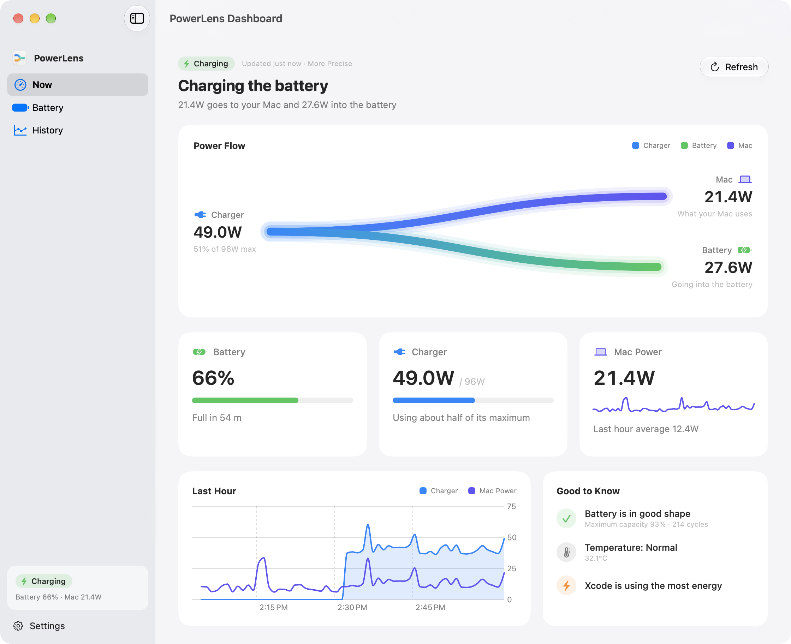
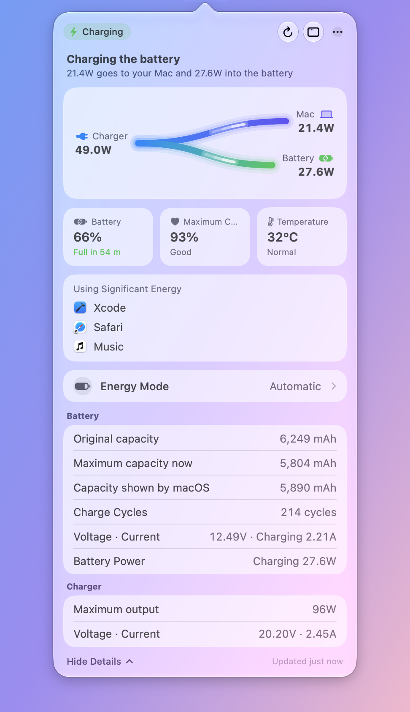
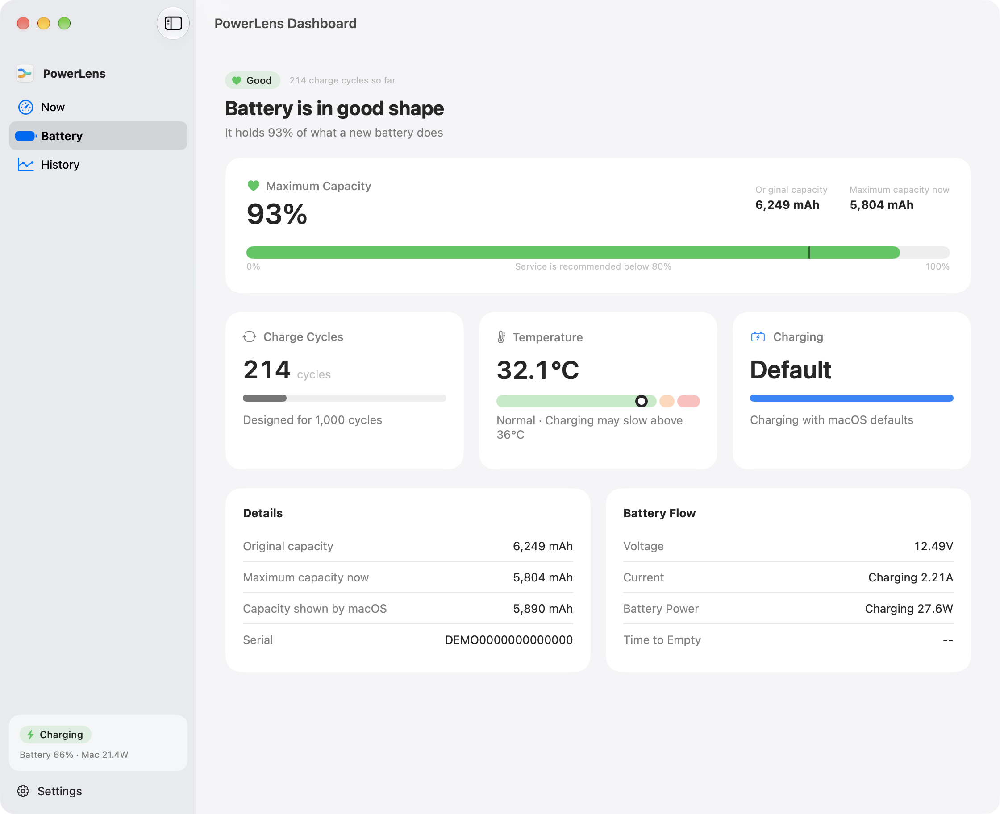
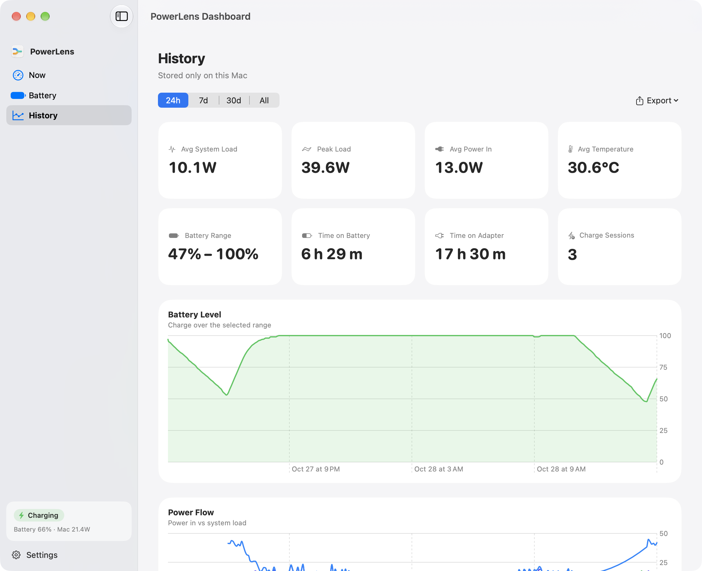
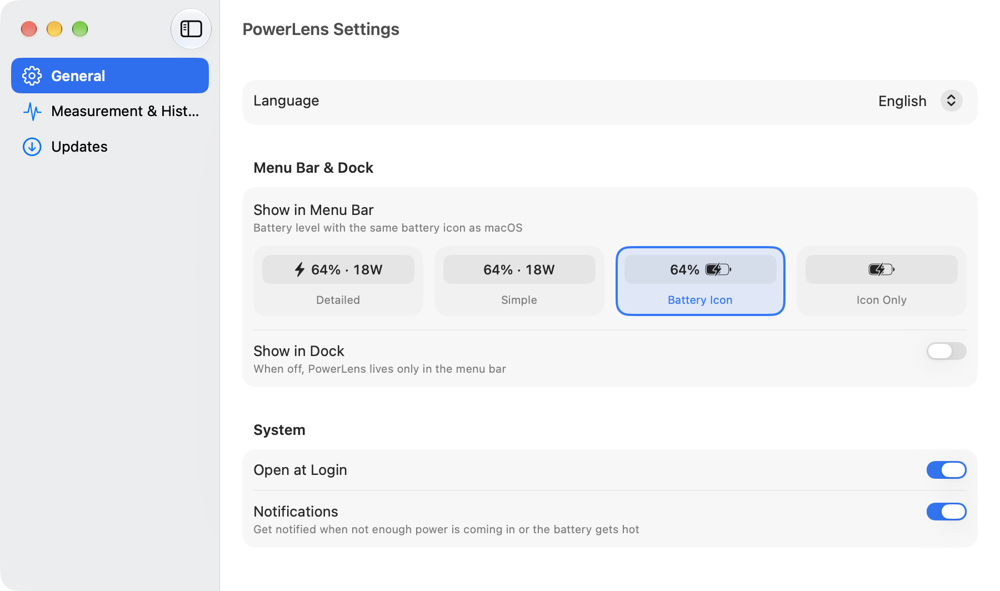

<div align="center">
  

  <h1>PowerLens</h1>

  <p><strong>See where your Mac's power goes, right from the menu bar.</strong></p>

  <p>
    <a href="https://github.com/progresshans/powerlens/releases/latest"></a>
    <a href="LICENSE"></a>
    
    
    
  </p>
</div>

PowerLens is a menu bar app for Apple silicon Macs. It shows how power
moves between your charger, your battery, and your Mac, and says what is
happening in plain language: whether the charger is enough, how much is going
into the battery, and when the battery has to help. Everything it measures
stays on your Mac.

<p align="center">
  
</p>

## What You Can See

### The Menu Bar Popover



Click the menu bar item for a quick check:

- **Status in plain words**, such as *Charging the battery: 21.4W goes to
  your Mac and 27.6W into the battery*.
- **Power flow** drawn as soft strands whose width follows the watts. The
  battery joins the picture only while it is charging or supplying power.
- **Battery, maximum capacity, and temperature** at a glance.
- **Apps using significant energy**, up to three, sampled only while the
  popover or Dashboard is open.
- **Energy mode** (Automatic, Low Power, or High Power), with a shortcut to
  Battery settings.
- **Details** on demand: capacities, cycles, voltage and current, and charger
  output.

The menu bar item itself comes in four styles: Detailed, Simple, Battery Icon,
and Icon Only. In Low Power Mode the battery icon fills yellow, as it does in
macOS, and a red badge appears when not enough power is coming in.

<br clear="right">

### The Dashboard

The Dashboard gives the same readings more room across three pages.

- **Now**: the power flow, battery, charger, and Mac power cards, a chart of
  the last hour, and notes about battery health, temperature, and the app using
  the most energy.
- **Battery**: maximum capacity compared with the original, charge cycles
  against the design target, temperature (warm from 36°C, hot from 40°C), and
  the charging setting macOS is applying, such as a charge limit or Optimized
  Battery Charging.
- **History**: 24 hours, 7 days, 30 days, or everything, with summary numbers,
  charts you can scrub, and long-term battery health and cycle trends. Export
  the saved samples as CSV or JSON.

<table>
  <tr>
    <td></td>
    <td></td>
  </tr>
</table>

### When Power Runs Short

PowerLens watches the power flow over time instead of reacting to every
sample:

| Status | What it means |
| --- | --- |
| Charging the battery | The charger covers the Mac and sends the rest into the battery. |
| The charger is enough | The charger covers the Mac while the battery rests. |
| Battery is helping out briefly | A short load spike draws on the battery. This is normal. |
| Not enough power coming in | The Mac keeps using more than comes in, and the battery covers the difference. PowerLens reports what it measures and does not guess whether the charger, cable, or dock is the cause. |
| Running on battery | Shows the time left and what the Mac is using right now. |

Charge limits and Optimized Battery Charging get their own statuses. You can
also turn on notifications for when not enough power is coming in or the
battery gets hot.

### Settings

<p align="center">
  
</p>

- **General**: language (English or Korean), menu bar style, Dock icon, Open
  at Login, and notifications.
- **Measurement & History**: the measurement method (Automatic, Reliable, or
  More Precise) and how long history is kept.
- **Updates**: Stable or Alpha channel and automatic update checks.

<sub>Screenshots use the app's demo mode, which shows scripted readings so
every part of the interface has something to display.</sub>

## How PowerLens Reads Power

Power sensors on a Mac update at slightly different moments, so raw readings
rarely add up. PowerLens calculates the displayed values from the system power
reading, so charger, battery, and Mac power always balance and stay within the
charger's rating. Hover over a value to see the original sensor readings and
how it was calculated. History and diagnostics keep the original measurements.

A reading PowerLens cannot get is shown as unknown, never as a healthy default.
Battery power calculated from current and voltage is marked with `≈`.

## Private by Design

PowerLens reads battery and power information locally. It sends no analytics,
telemetry, or crash reports, and it needs no account.

History is stored in a local SQLite database under
`~/Library/Application Support/PowerLens`. You choose how long full-detail
samples stay (30 days, 90 days, 1 year, or forever) and whether older data is
kept as hourly or daily summaries. See [PRIVACY.md](PRIVACY.md) for exactly
what is read and stored.

## Requirements

- A Mac with Apple silicon (M1 or later). Intel Macs are not supported.
- macOS 26 or later. Tested on macOS 26.
- A built-in battery for battery readings.
- Xcode or the Xcode command line tools to build from source.

## Install

1. Download the latest `PowerLens-<version>.dmg` from
   [Releases](https://github.com/progresshans/powerlens/releases/latest).
2. Open the DMG and drag `PowerLens.app` into `Applications`.
3. Launch PowerLens from `Applications`.

Release builds are Developer ID signed and notarized. PowerLens checks for
updates with Sparkle from the app menu or Settings.

### Verify the Download

Each release includes `PowerLens-<version>-checksums.txt`. Download it into the
same folder as the DMG, then run:

```bash
grep "PowerLens-<version>.dmg$" PowerLens-<version>-checksums.txt | shasum -a 256 -c -
```

## Uninstall

Quit PowerLens, then remove `PowerLens.app` from `Applications`. To delete
local history and preferences as well, follow
[PRIVACY.md](PRIVACY.md#delete-local-data).

## Build From Source

```bash
swift build --build-system native --arch arm64
./script/test_swiftpm.sh
./script/build_and_run.sh
```

`./script/build_and_run.sh` builds `dist/PowerLens.app` and launches it. It must
run from a native Apple silicon shell; Rosetta and Intel hosts are rejected.
Pass `debug`, `logs`, `telemetry`, or `verify` for the helper modes documented
in the script. With Swift 6.3 or later, run
`POWERLENS_BUILD_SYSTEM=swiftbuild ./script/test_swiftpm.sh` to match the
SwiftBuild path in CI.

Debug builds also accept `--demo`, which replaces live readings and history
with scripted ones. [docs/assets/screenshots](docs/assets/screenshots/README.md)
explains how the README screenshots are captured. Release packaging notes for
maintainers live in [Packaging/README.md](Packaging/README.md).

## Contributing and Security

Read [CONTRIBUTING.md](CONTRIBUTING.md) before opening an issue or pull request.
Ordinary changes target `develop`.

Report suspected vulnerabilities privately through
[GitHub Security Advisories](https://github.com/progresshans/powerlens/security/advisories/new)
instead of a public issue. See [SECURITY.md](SECURITY.md) for the process.

## License

Copyright (C) 2026 HYEONJIN HAN.

PowerLens is licensed under the GNU Affero General Public License v3.0 only
(`AGPL-3.0-only`). See [LICENSE](LICENSE).
